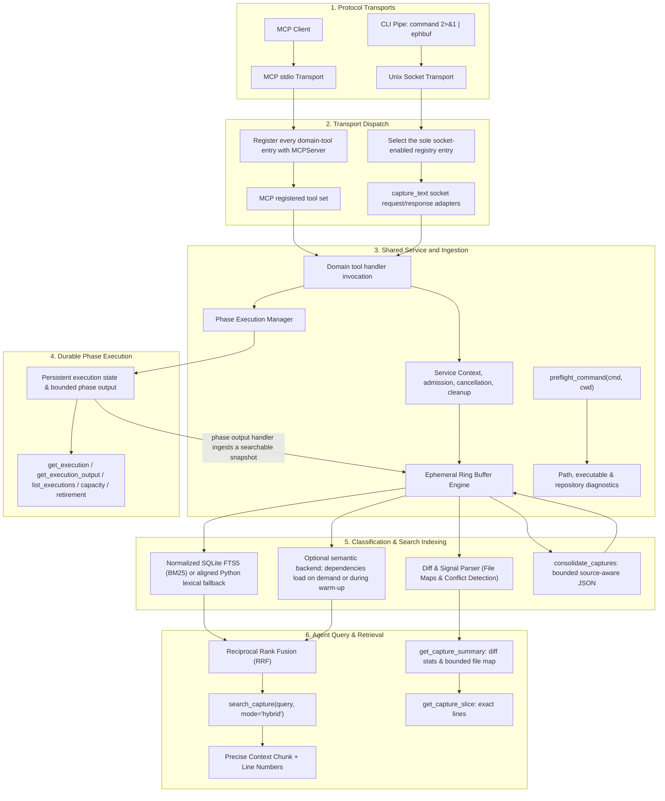

# Architecture and flow

`server.py` owns service configuration, contexts, and shared runtime resources.
The supported Python embedding API is `create_mcp_server` and
`create_service_context`. Transport modules load lazily: importing the core
server does not import the MCP SDK, and starting the socket transport does not
load MCP modules.

The transport boundaries expose different entrypoints. `mcp_transport.py`
loads the domain registrations and registers each one with MCPServer. It also
binds calls to their service context, applies MCP middleware and admission,
converts results to MCP responses, and fits responses to their size limits.
`socket_transport.py` selects the unique registry entry with socket adapters;
that entry is `capture_text`. Its request adapter maps the framed socket payload
to the capture handler, and its response adapter maps the handler result to the
socket wire format. The socket transport does not expose the MCP tool set.

`mcpserver_adapter.py` contains the MCP SDK compatibility boundary. Tool
registration uses MCPServer's public `add_tool` API. Optional validation-failure
metrics use a narrowly contained SDK-internal validation hook because the SDK
does not expose a registration hook for them. Instruction refresh first tries
the public property and falls back to the low-level server only when the SDK
does not allow setting it. If either optional integration is incompatible or
fails, the tool remains registered and dispatchable; validation metrics may be
unavailable or partial, or instruction refresh may be unavailable. Runtime
diagnostics report these limitations.

BM25 indexes case-folded compatibility-normalized tokens with diacritics
removed. Query parsing and the Python fallback use the same token rules, while
the capture's original lines and chunks remain the source for snippets and
line mapping. Search labels are bounded in the structured response. Capture
inventory uses bounded 25-entry pages and signed creation-sequence cursors, so
later captures and LRU touches do not move entries between pages; evicted
captures may be absent when a later page is read.

On MCP dispatch, `mcp_transport.py` injects `__invocation_mode="mcp"` for
handlers that support it. It also injects `__background=True` for registrations
marked for background execution, currently `start_execution` and
`resume_execution`. These are internal dispatch parameters, omitted from the
public tool schema; they are not caller-supplied tool arguments. Invocation
mode lets handlers and instrumentation apply MCP-specific behavior. The
background flag makes those execution handlers schedule work and return
promptly, while direct Python calls remain synchronous.

Execution output has two forms of retention. Each phase's bounded output is
stored with the durable execution record. The execution tool handlers pass an
output handler that ingests each returned phase result as a searchable capture
in the ordinary bounded ring. These phase captures count against the same
capture, byte, and index-chunk budgets as other captures and can therefore
cause normal LRU evictions. Evicting a capture does not delete its durable
execution record.

## Python module map

The map covers every Python module currently under `src/ephemeral_buffer_mcp/`.

### Service, storage, and execution

- `__init__.py` — lazily exports the supported Python embedding interfaces.
- `server.py` — builds service contexts, owns shared runtime resources, and
  lazily starts transports.
- `config.py` — resolves environment-backed settings, session identity, and
  durable execution state paths.
- `admission.py` — bounds active and queued MCP tool and socket work.
- `engine.py` — ingests and retains captures, classifies content, and supports
  lexical and optional semantic search and indexing. It resolves semantic
  settings into an immutable configuration and implements the typed capture
  store used by the coordinator while retaining ownership of capture lifetimes.
- `semantic_index.py` — coordinates embedding inference, semantic indexing,
  prefetch, and bounded indexing jobs for retained captures. It owns semantic
  configuration and scheduler state behind `SemanticIndexConfig` and the
  `SemanticCaptureLease` / `SemanticCaptureStore` boundary; the engine passes
  the shared lock so capture eviction and embedding publication remain
  synchronized.
- `embedding_backend.py` — loads the BGE-small ONNX model and tokenizer and
  yields normalized text embeddings.
- `execution.py` — runs durable, resumable command phases and manages their
  persistent state, bounded output, quotas, and lifecycle.
- `process_control.py` — tracks process identity and safely cleans up or recovers
  command process groups for durable execution.
- `capture_utils.py` — runs bounded commands and reads bounded files, including
  process cleanup for command capture.

### Transports and protocol

- `cli.py` — sends command output to the local service over the Unix socket.
- `socket_protocol.py` — defines socket frame encoding, decoding, and payload
  contracts.
- `socket_transport.py` — manages the Unix socket lifecycle and dispatches its
  single registry-selected capture entrypoint.
- `mcp_transport.py` — assembles MCPServer, registers the MCP tool set, binds
  service context and middleware, applies each registration's explicit
  `structured_envelope` or `legacy_text` result policy, validates versioned
  payload contracts at the MCP boundary, and converts and bounds results.
- `mcpserver_adapter.py` — isolates MCP SDK compatibility integrations,
  publishes registered output schemas, and reports when optional capabilities
  degrade.
- `mcp_response.py` — defines transport-neutral structured tool results,
  publishes their composed output schema, and measures response size.

### Runtime and response support

- `logging_utils.py` — provides privacy-safe structured logging.
- `metrics.py` — collects opt-in, content-free local usage metrics.
- `response_formatting.py` — formats and truncates UTF-8 and JSON text within
  byte limits.
- `response_limits.py` — centralizes response and metadata size limits.
- `schema_versions.py` — defines versions for public response schemas.

### Tool registry and shared context

- `tools/__init__.py` — imports domain modules in stable order and loads their
  registrations.
- `tools/registry.py` — stores handler metadata and selects the unique
  socket-enabled registration. Each registration declares its result policy;
  execution registrations also declare their MCP response fitter. Categories
  remain descriptive metadata.
- `tools/payloads.py` — defines strict, per-tool payload models for durable
  execution, search, and retrieval results, including compact success and
  malformed-record summaries used when responses are bounded. Their
  `payload_schema_version` is independent of the MCP envelope and any
  durable-record version.
- `tools/_context.py` — bridges domain handlers to the active service context.
- `tools/instrumentation.py` — wraps handlers with content-free metrics and
  lifecycle logging.

### Tool domains and helpers

- `tools/capture.py` — implements text, file, and command capture, plus capture
  consolidation and the socket capture adapters.
- `tools/configuration.py` — implements runtime configuration tools, including
  semantic index budget adjustment.
- `tools/diagnostics.py` — implements buffer, runtime, and usage diagnostics.
- `tools/execution.py` — implements command preflight and durable execution
  tools, including start, resume, cancellation, retrieval, and retirement.
- `tools/execution_responses.py` — builds execution responses and ingests phase
  output into the searchable capture ring and fits oversized execution results
  to the complete MCP text-plus-structured budget before returning them.
- `tools/formatting.py` — builds bounded summary and diff-file-map payloads.
- `tools/retrieval.py` — implements capture listing, clearing, summaries, and
  exact-line retrieval, including version-aware response sizing for paged
  capture slices.
- `tools/search.py` — implements capture search and result rendering.
- `tools/summary.py` — builds shared capture summary JSON and responses.

## Admission and storage bounds

Admission control limits active and queued MCP and socket work before requests
run. Active caps are process-wide across all MCP event loops and the socket
server's separate event loop: defaults allow 8 MCP calls, 4 socket clients, and
1 diagnostic call, matching the shared 13-worker executor. Configured queue
limits remain per event loop. Each loop keeps FIFO order, while the process
arbiter rotates grants among loops waiting for the same lane. Diagnostics keep
their own worker slot while MCP and socket lanes are saturated. The capture
engine maintains a bounded LRU buffer; its default limits are
256 captures and 50 MiB of captured UTF-8 content, with a separate lexical
index-chunk budget. When a new capture would exceed a configured limit, least-
recently-used captures are evicted to make room when possible; an individual
capture that cannot fit within a configured budget is rejected.

Each evicted capture records every limit still exceeded when that LRU removal
is planned (`count`, `bytes`, and/or `chunks`). Runtime index-budget reductions
and explicit clears are recorded as `budget` and `clear`. Fixed reason counters
are available in buffer stats and opt-in usage metrics. Capture admission
responses include up to 25 evicted capture IDs and their reasons, plus an
omitted count; runtime budget adjustment results use the same bound. A missing
capture is reported as an empty buffer only when no captures remain.

Durable execution records use a separate state directory and quota. The
aggregate state quota defaults to 4 GiB, with a configurable checkpoint
reserve for atomic writes. Capture eviction does not remove durable execution
records.

The shared runtime imports without NumPy, ONNX Runtime, Hugging Face Hub, or
Tokenizers. The default `ephemeral-buffer-mcp` distribution installs these
through the semantic extra; the explicit `ephemeral-buffer-mcp-lexical`
distribution omits them. Pillow is not required because the backend handles
the supported BGE-small ONNX model directly. In a
lexical-only install, BM25 remains available and hybrid or semantic searches
return `semantic_backend_unavailable`. With the semantic extra installed, the
dense model loads on demand and may be warmed in the background after startup.
