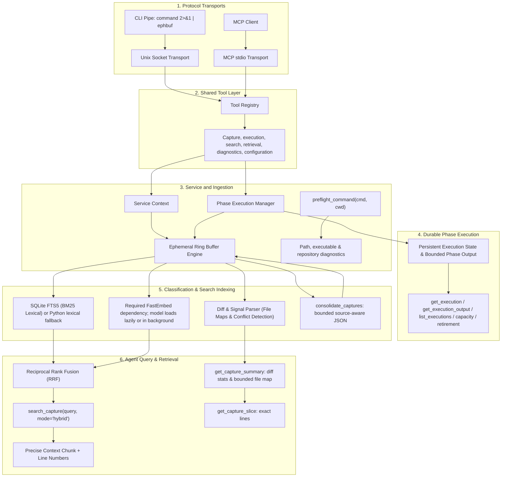

# Architecture and flow

`server` owns service configuration, contexts, and shared runtime resources.
The MCP and Unix socket adapters are loaded only when their transports start;
the core server import does not import the MCP SDK. The tool registry imports
domain modules in a stable order and exposes the same handlers to both
transports. The supported Python embedding API remains `create_mcp_server`
and `create_service_context`.

## Admission and storage bounds

Admission control limits active and queued MCP and socket work before requests
run. The capture engine maintains a bounded LRU buffer; its default limits are
256 captures and 50 MiB of captured UTF-8 content, with a separate lexical
index-chunk budget. When a new capture would exceed a configured limit, least-
recently-used captures are evicted to make room when possible; an individual
capture that cannot fit within a configured budget is rejected.

Each evicted capture records every limit still exceeded when that LRU removal
is planned (`count`, `bytes`, and/or `chunks`). Runtime index-budget reductions
and explicit clears are recorded as `budget` and `clear`. Fixed reason counters
are available in buffer stats and opt-in usage metrics. Capture admission
responses include up to 25 evicted capture IDs and their reasons, plus an
omitted count; runtime budget adjustment results use the same bound. A missing
capture is reported as an empty buffer only when no captures remain.

Durable execution records use a separate state directory and quota. The
aggregate state quota defaults to 4 GiB, with a configurable checkpoint
reserve for atomic writes. Capture eviction does not remove durable execution
records.

FastEmbed is an import-time dependency of the engine. Loading the dense model
is lazy when semantic search first needs it; deployments may also warm the
model in the background after startup.

---
